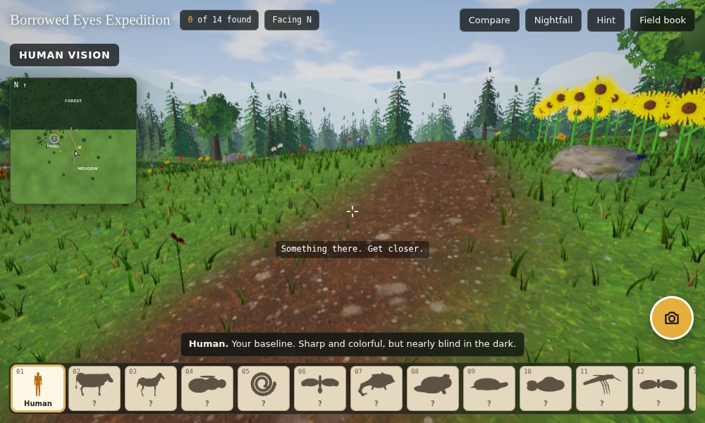
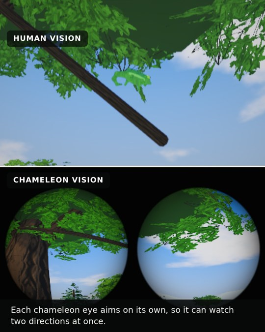
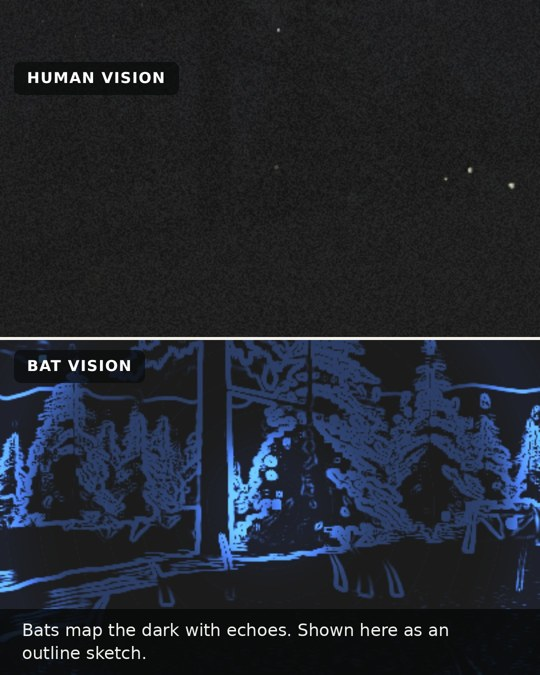

# Borrowed Eyes

A browser game about how other animals see. You start in a 3D valley with human eyes. Fourteen animals are hidden around it, and when you find one and photograph it, you get to see the world through its eyes. Some animals only come out at night, so the eyes you collect early help you find the rest.

| Chameleon | Bat |
|---|---|
|  |  |

## Play

Open `index.html` in a current desktop or mobile browser (Chrome, Edge, Firefox or Safari). It needs WebGL 2 and loads three.js and Google Fonts from a CDN, so it needs an internet connection. To host it, turn on GitHub Pages for this repository (Settings, Pages, deploy from the `main` branch root).

`viewer/index.html` is the earlier 2D version: three painted scenes viewed through eight animals' eyes, with a side-by-side comparison slider.

**Controls:** W A S D or arrow keys to move, the mouse to look (click into the game to capture it, Esc to release), Space and Shift to rise and drop, and a left click or F to take a photo. On a phone, drag the left side to move, drag the right side to look, and use the on-screen buttons. Q and E switch between eyes you own, C compares with human vision, N toggles night, H shows a hint, B opens the field book and M enlarges the map.

## The animals

Cow, horse, honeybee, rattlesnake, red-tailed hawk, chameleon, frog, turtle, goldfish, mosquito, bat, scorpion, great horned owl and white-tailed deer. Each one changes some combination of color (based on which photoreceptors the animal has), sharpness, field of view, sensitivity in dim light, flicker rate (shown as slow motion), heat sensing, and ultraviolet.

## How accurate is it?

The effects are approximations based on published research, and some are deliberately stylized:

- Well supported: two-color vision in cows, horses and deer; wide fields of view with a blind spot in front for cows and horses; ultraviolet vision and compound eyes in bees; heat-sensing pit organs in rattlesnakes; an ultraviolet cone in goldfish; frogs seeing color in very dim light; rod-dominated owl eyes; red oil droplets in turtle cones; independently moving chameleon eyes; mosquitoes finding hosts by heat and carbon dioxide.
- Stylized: ultraviolet has no color on a screen, so it is shown as blue or violet by convention. The bat's echolocation is drawn as an outline sketch from the image rather than from real echo distances. The chameleon's two eyes point at fixed angles. A flat screen cannot show a horse's 350° view, so wide-eyed animals get the widest view a screen can manage.
- Not to scale: the bee, mosquito, frog, scorpion, goldfish, chameleon and turtle are enlarged so they can be found.

## How it is built

A single HTML file with three.js. Nothing is loaded from image or model files: the terrain textures, trees, grass, sky and clouds are generated in code, and the animals are sculpted from smooth signed-distance shapes and turned into meshes when the page loads. Each frame renders a color pass, an ultraviolet pass and a heat pass, and a post-processing shader combines them into each animal's view.
